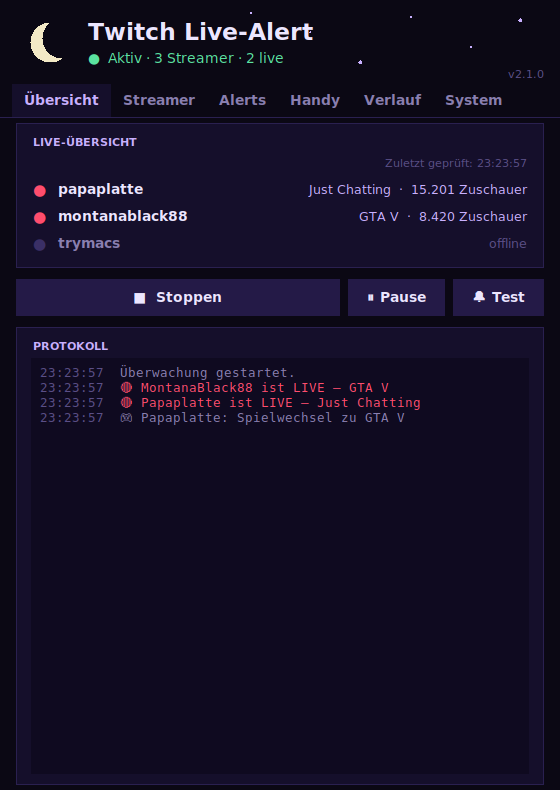
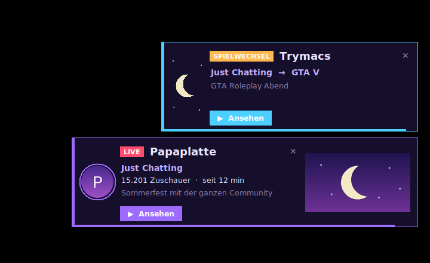
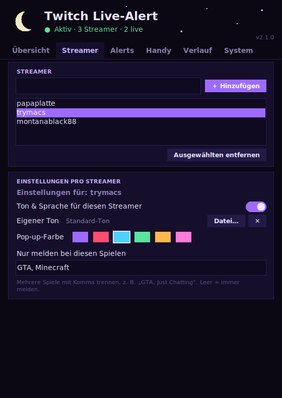
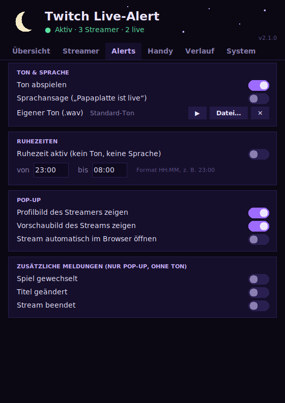
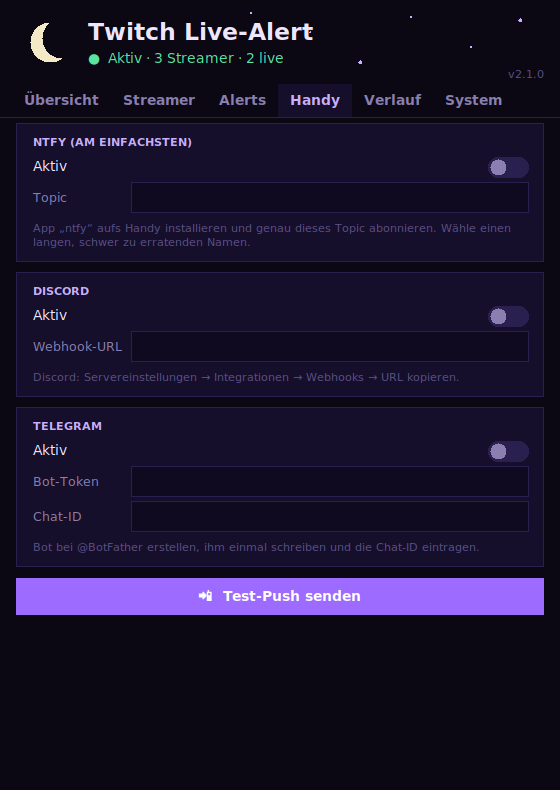
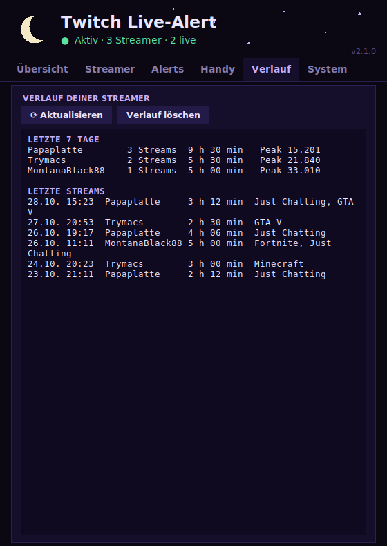

<div align="center">

# 🌙 Twitch Live-Alert

**Dein Mond-Wächter für Twitch.**<br>
Ein kleines Windows-Programm, das dich benachrichtigt, sobald deine Lieblings-Streamer live gehen – im dunklen Schwarz-Lila-Mond-Design.


<br>

&nbsp;&nbsp;&nbsp;

</div>

---

## ✨ Funktionen

| | |
|---|---|
| 🔔 **Live-Alerts** | Pop-up unten rechts mit Profilbild, Vorschaubild, Spiel, Titel, Zuschauerzahl und Live-Dauer |
| 📺 **Live-Übersicht** | Alle Streamer auf einen Blick – Klick öffnet den Stream |
| 🎛️ **Pro Streamer einstellbar** | Eigener Ton, eigene Pop-up-Farbe, Spielfilter („nur bei GTA melden") |
| ⏸️ **Pause** | Alerts für 30 Minuten bis „bis ich fortsetze" abschalten |
| 🌙 **Ruhezeiten** | Nachts kein Ton und keine Sprache, das Pop-up bleibt |
| 🔊 **Ton & Sprache** | Eigene `.wav`-Datei und Sprachansage („Papaplatte ist live") |
| 🎮 **Zusatzmeldungen** | Spiel gewechselt, Titel geändert, Stream beendet |
| 📲 **Handy-Push** | Über [ntfy](https://ntfy.sh), Discord oder Telegram |
| 📊 **Verlauf** | Wer wann wie lange live war, Zuschauer-Peak der letzten 7 Tage |
| 🪟 **Infobereich** | Läuft unsichtbar neben der Uhr weiter, auf Wunsch minimiert gestartet |
| 🔄 **Updates** | Prüft beim Start auf neue Versionen (Python-Variante aktualisiert sich selbst, die `.exe` verweist auf den Download) |

---

## 📥 Download (ohne Python)

Du willst nichts installieren? Dann nimm die fertige Windows-Version:

1. Öffne die **[Release-Seite](https://github.com/AwayToMoon/Twitch-Alerts/releases/latest)**.
2. Lade unter **Assets** die Datei **`TwitchLiveAlert.exe`** herunter.
3. Lege sie in einen **eigenen Ordner**, zum Beispiel `C:\TwitchAlert`. Dort speichert sie ihre Einstellungen.
4. Starte sie per Doppelklick und richte den Twitch-Zugang ein (Schritt 4 und 5 unten).

> ⚠️ **Windows-Warnung:** Die Datei ist nicht digital signiert. Windows zeigt deshalb beim ersten Start „Der Computer wurde durch Windows geschützt". Klicke auf **Weitere Informationen → Trotzdem ausführen**. Manche Virenscanner schlagen bei solchen Programmen auch fälschlich an. Wer dem nicht traut, nutzt die Python-Variante, der Quellcode ist offen einsehbar.

---

## 🚀 Schnellstart (mit Python)

### 1. Python installieren

Lade Python von [python.org](https://www.python.org/downloads/) herunter (empfohlen: **3.10 oder neuer**).
Setze bei der Installation den Haken bei **„Add Python to PATH"**.

### 2. Programm herunterladen

Lade die Datei [`twitch_alert_gui.py`](twitch_alert_gui.py) herunter und lege sie in einen eigenen Ordner, zum Beispiel `C:\TwitchAlert`.

### 3. Pakete installieren

Öffne die Eingabeaufforderung und gib ein:

```bash
python -m pip install requests pillow pystray
```

> `pillow` und `pystray` sind optional. Ohne sie fehlen die Bilder im Pop-up und das Symbol im Infobereich, alles andere funktioniert.

### 4. Twitch-API-Zugang holen

Twitch verlangt für die Abfrage einen kostenlosen Zugang:

1. Gehe auf die [Twitch Developer Console](https://dev.twitch.tv/console) und logge dich ein (dafür muss die **Zwei-Faktor-Authentifizierung** aktiviert sein).
2. Klicke auf **„Anwendung registrieren"**.
3. Trage ein:
   - **Name:** beliebig, aber einzigartig (zum Beispiel `MeinLiveAlert123`)
   - **OAuth-Redirect-URL:** `http://localhost`
   - **Kategorie:** `Application Integration`
4. Öffne die Anwendung, kopiere die **Client-ID** und klicke auf **„Neues Secret"**, um das **Client Secret** zu erzeugen.

### 5. Starten

```bash
python twitch_alert_gui.py
```

Trage im Tab **System** Client-ID und Client Secret ein, füge im Tab **Streamer** deine Lieblings-Streamer hinzu und klicke auf **▶ Starten**. Mit **🔔 Test** prüfst du, ob alles funktioniert.

---

## 🖥️ Ohne Konsolenfenster und mit Windows starten

1. Benenne `twitch_alert_gui.py` in **`twitch_alert_gui.pyw`** um (die Endung `.pyw` startet ohne schwarzes Fenster).
2. Finde den Pfad zu `pythonw.exe` heraus:
   ```bash
   where pythonw
   ```
3. Erstelle eine Verknüpfung (Rechtsklick auf den Desktop → Neu → Verknüpfung) mit diesem Ziel, angepasst an deine Pfade:
   ```
   "C:\Pfad\zu\pythonw.exe" "C:\TwitchAlert\twitch_alert_gui.pyw"
   ```
4. Für den **Autostart** kopierst du die Verknüpfung in den Autostart-Ordner (`Win + R`, dann `shell:startup`).

> 💡 Setze in den Einstellungen **„Minimiert starten"**, dann läuft das Programm nach jedem Windows-Start unsichtbar im Infobereich.

---

## 📖 Bedienung

Das Programm hat sechs Tabs:

| Tab | Was du dort findest |
|---|---|
| **Übersicht** | Live-Liste, Start/Stopp, Pause, Test und das Protokoll |
| **Streamer** | Streamer hinzufügen und entfernen, Einstellungen pro Streamer |
| **Alerts** | Ton, Sprache, Ruhezeiten, Pop-up-Optionen und Zusatzmeldungen |
| **Handy** | Push-Benachrichtigungen aufs Smartphone |
| **Verlauf** | Statistik und Liste der letzten Streams |
| **System** | API-Zugang, Prüfintervall, Autostart, Infobereich, Updates |

Alle Änderungen gelten **sofort**, ein Neustart ist nicht nötig.

<details>
<summary><b>📸 Weitere Screenshots</b></summary>

<br>

<table>
<tr>
<td></td>
<td></td>
</tr>
<tr>
<td></td>
<td></td>
</tr>
</table>

*Beispieldaten, aufgenommen in einer Testumgebung.*

</details>

### Pro-Streamer-Einstellungen

Wähle im Tab **Streamer** einen Namen aus der Liste. Dann kannst du festlegen:

- **Ton & Sprache** für diesen Streamer an- oder abschalten
- einen **eigenen Ton** (`.wav`)
- die **Farbe** des Pop-ups
- einen **Spielfilter**, zum Beispiel `GTA, Just Chatting`. Es wird nur gemeldet, wenn das aktuelle Spiel einen dieser Begriffe enthält. Leer bedeutet: immer melden.

### Pause

Über **⏸ Pause** schaltest du die Alerts für 30 Minuten, 1, 2 oder 4 Stunden oder bis zum Fortsetzen ab. Ist ein Streamer nach der Pause noch live, bekommst du die Meldung dann nachträglich.

---

## 📲 Handy-Push einrichten

<details>
<summary><b>ntfy</b> – am einfachsten, ohne Konto</summary>

1. Installiere die App **ntfy** auf deinem Handy.
2. Abonniere dort ein Topic, zum Beispiel `mein-twitch-alert-x7k2q9`.
3. Trage dasselbe Topic im Tab **Handy** ein und aktiviere den Schalter.

Wähle einen **langen, schwer zu erratenden Namen**, denn jeder, der ihn kennt, kann mitlesen.
</details>

<details>
<summary><b>Discord</b></summary>

Servereinstellungen → Integrationen → Webhooks → neuen Webhook erstellen → URL kopieren und im Tab **Handy** einfügen.
</details>

<details>
<summary><b>Telegram</b></summary>

1. Erstelle einen Bot bei [@BotFather](https://t.me/BotFather) und kopiere den **Bot-Token**.
2. Schreibe dem Bot einmal eine Nachricht.
3. Trage Token und deine **Chat-ID** im Tab **Handy** ein.
</details>

Mit **📲 Test-Push senden** prüfst du die Einrichtung.

---

## 🔄 Updates

Beim Start vergleicht das Programm seine Versionsnummer mit der Datei in diesem Repository. Gibt es eine neuere Version, fragt es dich:

1. Die neue Datei wird heruntergeladen und auf Fehler geprüft.
2. Die alte Version bleibt als `twitch_alert_gui.pyw.bak` erhalten.
3. Das Programm startet automatisch neu.

Manuell suchst du im Tab **System** über **⟳ Jetzt nach Updates suchen**.

> ℹ️ Das automatische Ersetzen funktioniert nur bei `.py`/`.pyw`. Die `.exe` weist dich bei einer neuen Version stattdessen darauf hin und öffnet die Download-Seite.
> Wenn du dieses Projekt **forkst**, ändere in der Datei die Konstante `UPDATE_URL` auf dein eigenes Repository.

---

## 🔒 Datenschutz und Sicherheit

- Deine Einstellungen liegen **nur lokal** im Programmordner (`twitch_alert_config.json`). Dort stehen auch Client Secret und Push-Zugangsdaten.
- **Lade diese Datei niemals auf GitHub hoch** und gib sie nicht weiter.
- Es werden keine Daten an Dritte gesendet, außer an die Dienste, die du selbst aktivierst: Twitch (Abfrage und Bilder), GitHub (Update-Check) und optional ntfy, Discord oder Telegram.

---

## 🛠️ Fehlerbehebung

<details>
<summary><b>Ich bekomme keinen Alert</b></summary>

- Klicke auf **🔔 Test**. Kommt das Pop-up, funktioniert die Anzeige.
- Steht im Protokoll **„API-Fehler"**, stimmen Client-ID oder Client Secret nicht.
- Der Streamer muss mit seinem **Login-Namen** eingetragen sein (der Teil aus `twitch.tv/NAME`).
- Prüfe, ob die Alerts per **Pause** abgeschaltet sind (oben im Fenster steht dann „pausiert").
- Prüfe einen eventuellen **Spielfilter** beim Streamer.
</details>

<details>
<summary><b>Der Ton fehlt</b></summary>

- Ist **Ton abspielen** im Tab **Alerts** an?
- Ist gerade eine **Ruhezeit** aktiv, oder ist der Ton für diesen Streamer abgeschaltet?
- Prüfe die Windows-Lautstärke und das Standard-Ausgabegerät.
</details>

<details>
<summary><b>Kein Symbol im Infobereich / keine Bilder im Pop-up</b></summary>

Installiere die optionalen Pakete:

```bash
python -m pip install pillow pystray
```
</details>

<details>
<summary><b><code>pip</code> wird nicht gefunden</b></summary>

Nutze immer die Form `python -m pip install ...`. Dann wird garantiert dasselbe Python verwendet, mit dem du das Programm startest.
</details>

<details>
<summary><b>Doppelklick auf die <code>.pyw</code> öffnet ein Auswahlmenü</b></summary>

Windows kennt die Endung noch nicht. Nutze die Verknüpfung aus dem Abschnitt „Ohne Konsolenfenster und mit Windows starten“.
</details>

---

## 📁 Dateien

| Datei | Zweck |
|---|---|
| `twitch_alert_gui.py` | Das Programm (alles in einer Datei) |
| `twitch_alert_config.json` | Deine Einstellungen, wird automatisch erzeugt |
| `twitch_alert_verlauf.json` | Der Stream-Verlauf, wird automatisch erzeugt |
| `twitch_alert_gui.pyw.bak` | Sicherung der Vorversion nach einem Update |

### Optional: als `.exe` bauen

```bash
python -m pip install pyinstaller
python -m PyInstaller --clean --onefile --noconsole --name TwitchLiveAlert --icon twitch_alert.ico --hidden-import pystray._win32 twitch_alert_gui.py
```

Die Datei `twitch_alert.ico` (das Mond-Symbol) muss dafür im selben Ordner wie das Programm liegen.

Die fertige `TwitchLiveAlert.exe` liegt danach im Ordner `dist`.

**Als Release veröffentlichen:** Im Repository unter **Releases → Create a new release** eine Versionsnummer wie `v2.1.0` vergeben (**Create new tag**), die `.exe` unten bei „Attach binaries“ hineinziehen und auf **Publish release** klicken.

---

## ⚖️ Hinweis

Dieses Projekt ist ein privates Hobbyprojekt und steht in keiner Verbindung zu Twitch Interactive, Inc. „Twitch" ist eine Marke der jeweiligen Inhaber.

<div align="center">

<sub>Gebaut mit 🌙 und Python</sub>

</div>
